# Acceptance test cases

Each case is a use case (or goal) of the SRS v1.1 run on the real app, on real hardware - nothing is
simulated. The cases were executed by `tests/acceptance/run_acceptance.py`, which opens the app, calls
the same handlers the buttons and the diagram are wired to, waits for the app's real reaction, and
captures the window and every pop-up (Win32 `PrintWindow`; pop-ups from the screen). The observed
results below are what that run recorded (`tests/work/acceptance/results.json`); this page is written
from them by `tests/acceptance/write_doc.py`. Each case can also be done by hand with the steps given.

**Result of the last run: 10 of 11 passed.** Machine: 32 GB RAM, 12th Gen Intel(R) Core(TM) i7-12700K (12C/20T), NVIDIA GeForce RTX 3080 Ti, ASUSTeK COMPUTER INC. ROG STRIX Z690-E GAMING WIFI, Samsung SSD 980 PRO 2TB (C:) - 2 TB SSD.

Not covered here, and why: **UC-12** (telemetry lost) and **UC-14** (thermal abort) can't be triggered safely on real hardware - pulling a sensor or overheating a part - so they are verified by the unit tests (`tests/unit/test_controller.py`, `SafetyTest`). **UC-2** (remote machine) was withdrawn in SRS v1.1.

**Observations from the run.** While the 2D test keeps every CPU core at 100 % (AT-3), the window itself gets less CPU: the clock read 40-57 FPS and 16-20 sensor samples per second instead of 60 / 20. The 10 Hz minimum of NFR-1 holds (the clock was recorded in AT-3 only; three runs gave 57 / 20, 49 / 17 and 40 / 16). Three defects were found by these runs and fixed, each with a regression test: doubled backslashes in an error pop-up (AT-7), garbled non-ASCII program output (AT-8), and a CPU-only test reported as "GPU waiting on the CPU" when another program used the GPU (AT-3). The driver itself had a defect: taking `PrintWindow` screenshots from a worker thread stalled Tk's timers for seconds at a time; it now captures on the window's own thread (every request answered in under 0.2 s).

| Case | Covers | Title | Result |
|---|---|---|---|
| [AT-1](#at-1) | UC-1, UC-10, UC-11 | Start the app: hardware detected, live readings | pass |
| [AT-2](#at-2) | UC-3, UC-4 | Select a component, then another | pass |
| [AT-3](#at-3) | UC-5, UC-9, UC-10, UC-11 | 2D workload on the CPU runs to completion | pass |
| [AT-4](#at-4) | UC-6 | 3D workload on the GPU | pass |
| [AT-5](#at-5) | UC-7 | AI Benchmark Mode | pass |
| [AT-6](#at-6) | UC-8 | Stop a running test | pass |
| [AT-7](#at-7) | UC-13 | Invalid start requests are refused | pass |
| [AT-8](#at-8) | Ultimate goal (SRS VI.3) | YOUR CODE: your own program and its bottlenecks | pass |
| [AT-9](#at-9) | Ultimate goal (SRS VI.3) | Hot spots in VS Code | **fail** |
| [AT-10](#at-10) | Stretch goals (SRS VI.2) | Compare two runs and replay a recording | pass |
| [AT-11](#at-11) | UC-5, UC-9; stretch goals | Other parts: RAM bandwidth, disk I/O, PCIe bus, ML | pass |

---

## AT-1

### Start the app: hardware detected, live readings

**Covers:** UC-1, UC-10, UC-11  
**Preconditions:** Windows PC; LibreHardwareMonitor running (for CPU / chipset temperature).

**Steps**

1. Start the app (`python main.py`).

**Expected:** The window opens; RAM, CPU, GPU, BOARD and DISK show the detected parts; the parts and the readout show live idle readings; nothing is selected.

**Observed:** pass.

- Status line: `CLICK A PART OR SEARCH TO SELECT IT`
- Detected: RAM 32 GB RAM; CPU 12th Gen Intel(R) Core(TM) i7-12700K (12C/20T); GPU NVIDIA GeForce RTX 3080 Ti; BOARD ASUSTeK COMPUTER INC. ROG STRIX Z690-E GAMING WIFI; DISK Samsung SSD 980 PRO 2TB (C:) - 2 TB SSD

**Screenshots**

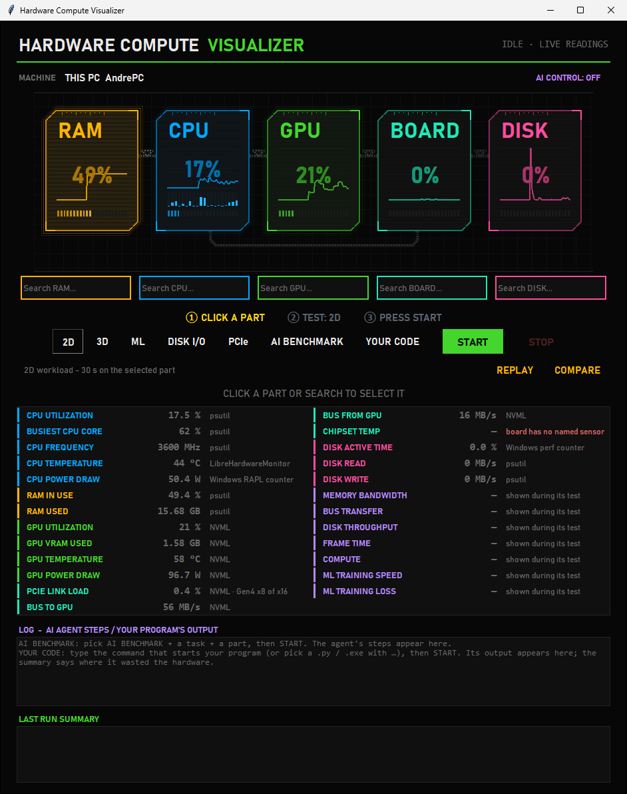

*AT-1_start_idle.png*

---

## AT-2

### Select a component, then another

**Covers:** UC-3, UC-4  
**Preconditions:** App open, no test running.

**Steps**

1. Click GPU in the diagram.
2. Click GPU again.
3. Click CPU.

**Expected:** The clicked part is outlined and named in the status line; clicking the selected part again changes nothing; selecting another part moves the selection.

**Observed:** pass.

- After GPU: `Selected: GPU — NVIDIA GeForce RTX 3080 Ti`; clicking GPU again: `Selected: GPU — NVIDIA GeForce RTX 3080 Ti`; after CPU: `Selected: CPU — 12th Gen Intel(R) Core(TM) i7-12700K (12C/20T)`

**Screenshots**

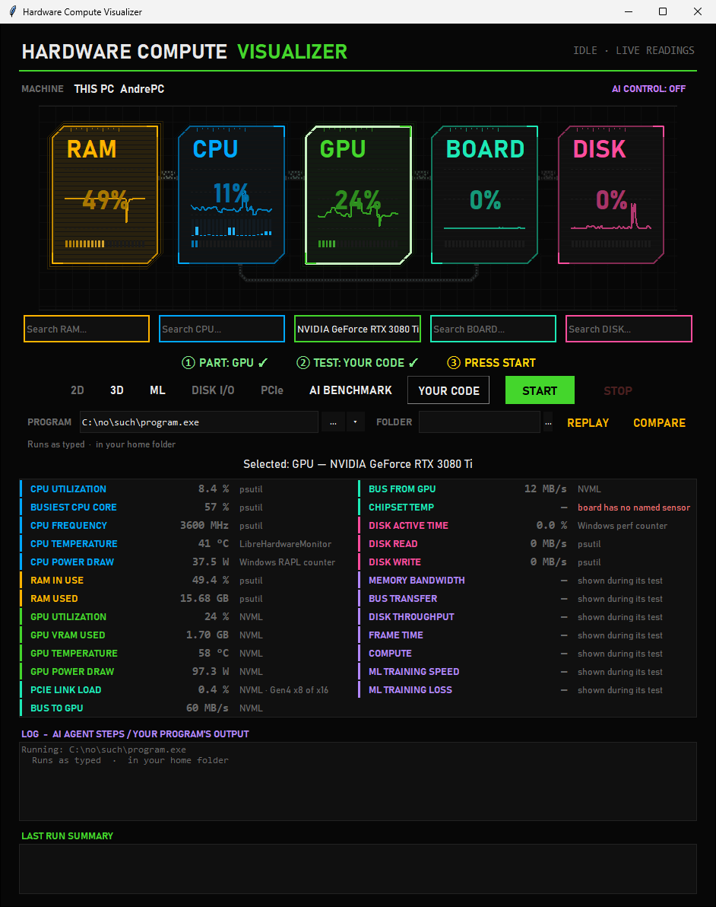

*AT-2a_gpu_selected.png*

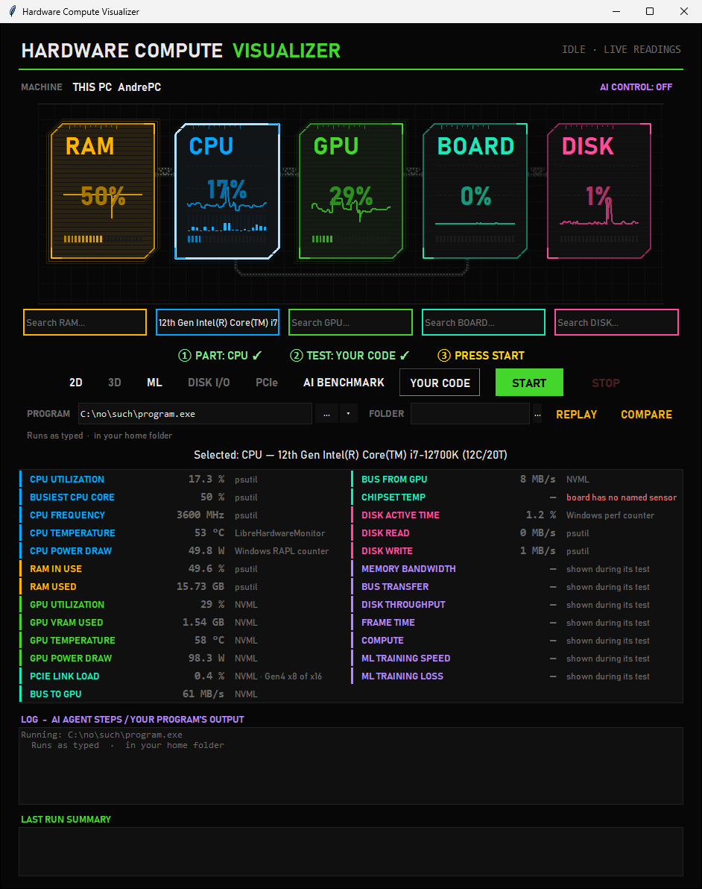

*AT-2b_cpu_selected.png*

---

## AT-3

### 2D workload on the CPU runs to completion

**Covers:** UC-5, UC-9, UC-10, UC-11  
**Preconditions:** App open.

**Steps**

1. Click CPU.
2. Choose 2D.
3. Press START.
4. Wait for the end (30 s).

**Expected:** Every core works (per-core bars all tall), the diagram and readout follow the real readings at about 60 FPS and 20 Hz; after 30 s the status says `completed` and the summary shows min / avg / peak per metric, the bottleneck finder's result, and that the run was recorded.

**Observed:** pass.

- Status line: `Test ended: completed`
- Clock while running: `○ LIVE   12.5s    40 FPS · 16 Hz`
- The window answered every request within 0.08 s

Summary (first lines, and the bottleneck finder's part):

```
Result: completed   Test: 2D workload on CPU   Duration: 30.2 s   Machine: AndrePC

Metric                      min        avg       peak  unit         prev avg   change
...
Bottlenecks (share of the run, longest stretches):
  ok  96%  All CPU cores busy - the CPU is the limit (good, parallel use)  [1-30 s]
          -> Faster only with a faster CPU or less work (better algorithm, moving work to the GPU).
```

**Screenshots**

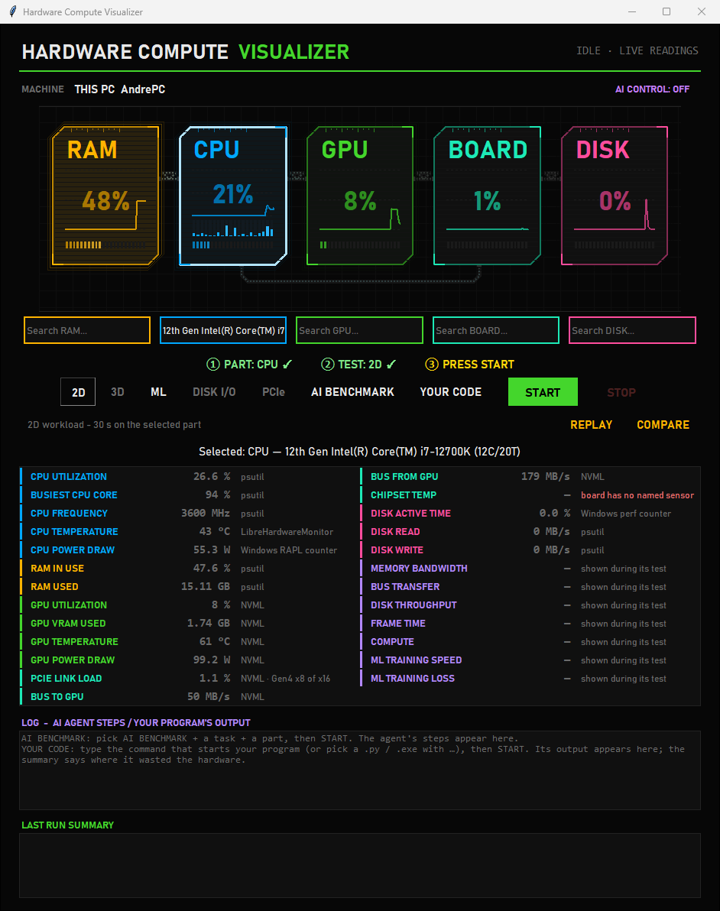

*AT-3a_cpu_2d_ready.png*

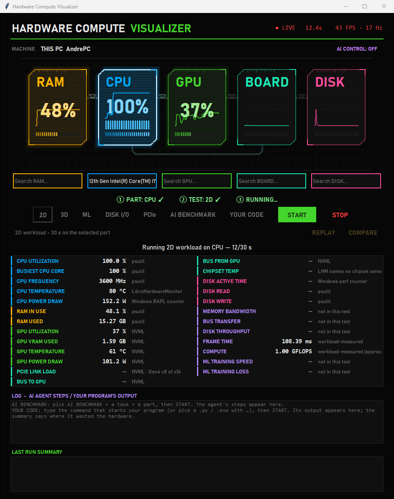

*AT-3b_cpu_2d_running.png*

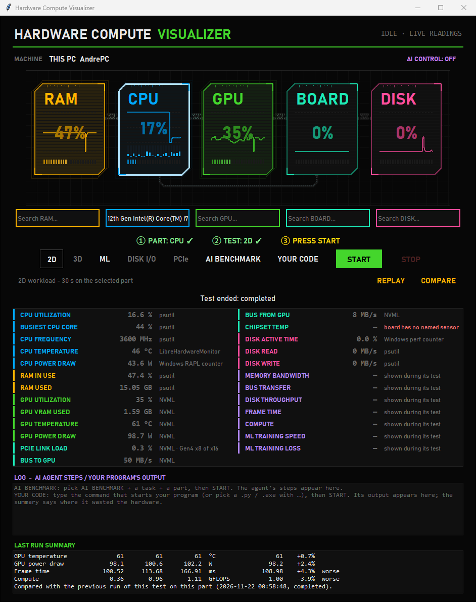

*AT-3c_cpu_2d_summary.png*

---

## AT-4

### 3D workload on the GPU

**Covers:** UC-6  
**Preconditions:** NVIDIA GPU; moderngl installed.

**Steps**

1. Click GPU.
2. Choose 3D.
3. Press START.
4. Wait for the end.

**Expected:** The GPU is near 100 %, frame time is measured, the CPU and board are shown as working alongside; the run completes with a summary.

**Observed:** pass.

- Status line: `Test ended: completed`

Summary (first lines, and the bottleneck finder's part):

```
Result: completed   Test: 3D workload on GPU   Duration: 30.4 s   Machine: AndrePC

Metric                      min        avg       peak  unit      
...
Bottlenecks (share of the run, longest stretches):
  ok  95%  GPU fully busy - the GPU is the limit (good use)  [2-30 s]
          -> Faster only with a faster GPU or less GPU work (lower precision, smaller model).
```

**Screenshots**

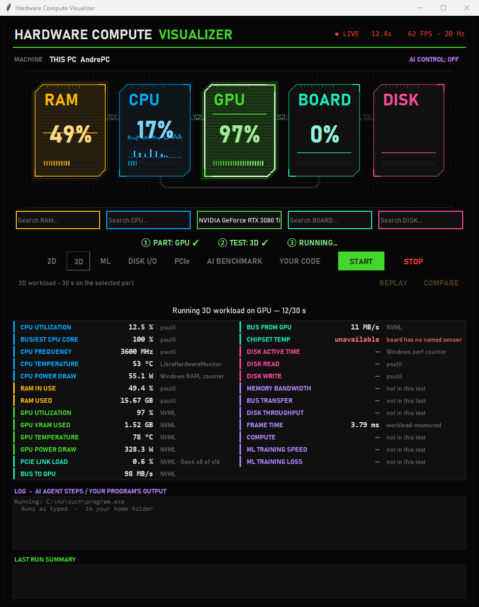

*AT-4a_gpu_3d_running.png*

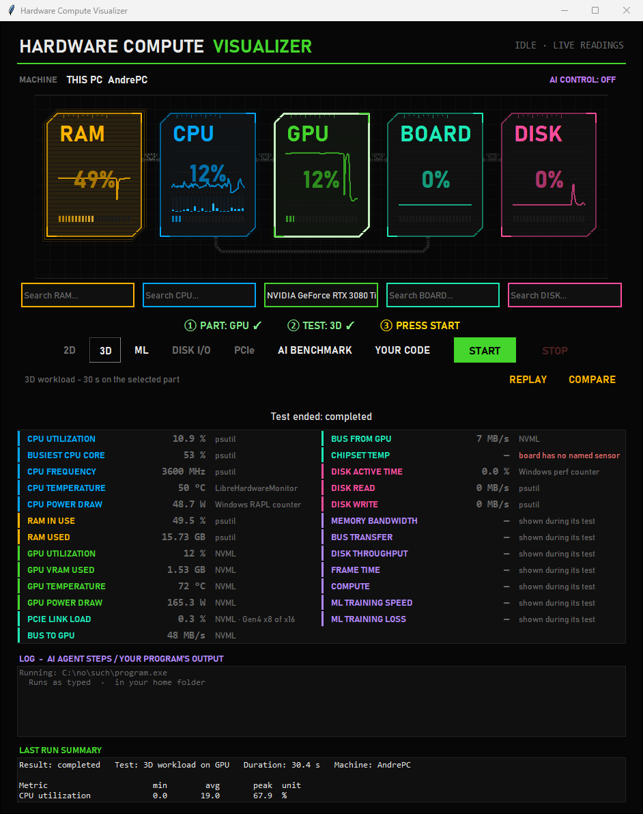

*AT-4b_gpu_3d_summary.png*

---

## AT-5

### AI Benchmark Mode

**Covers:** UC-7  
**Preconditions:** Ollama running with a tool-calling model.

**Steps**

1. Click GPU.
2. Choose AI BENCHMARK, task "Crunch big matrices".
3. Press START.
4. Wait for the end.

**Expected:** The log shows the agent's own steps (tool calls, results, any blocked actions); the run ends as `completed` only if the model called finish, otherwise as stopped / time limit; the summary counts the tool calls and blocked actions.

**Observed:** pass.

- Status line: `Test ended: completed`

Summary (first lines, and the bottleneck finder's part):

```
Result: completed   Test: AI benchmark on GPU   Duration: 200.0 s   Machine: AndrePC
Agent: 6 tool calls, 0 blocked action(s)
Agent said: Compared CPU and GPU speed for 4096x4096 float32 matrix multiplications. Numpy on CPU averaged ~0.16s per operation, while PyTorch on GPU averaged ~0.0005s per operation. The GPU achieved approximately 296x speedup over the CPU, with stable results across 3 runs.
...
Bottlenecks (share of the run, longest stretches):
   !  99%  GPU waiting on the CPU - it was idle while the CPU was busy  [39-153 s, 0-39 s, 178-200 s (+2 more)]
          -> Feed the GPU faster: bigger batches, load data in worker processes, keep data on the GPU, avoid per-step syncs such as .item() or printing tensors.
```

**Screenshots**

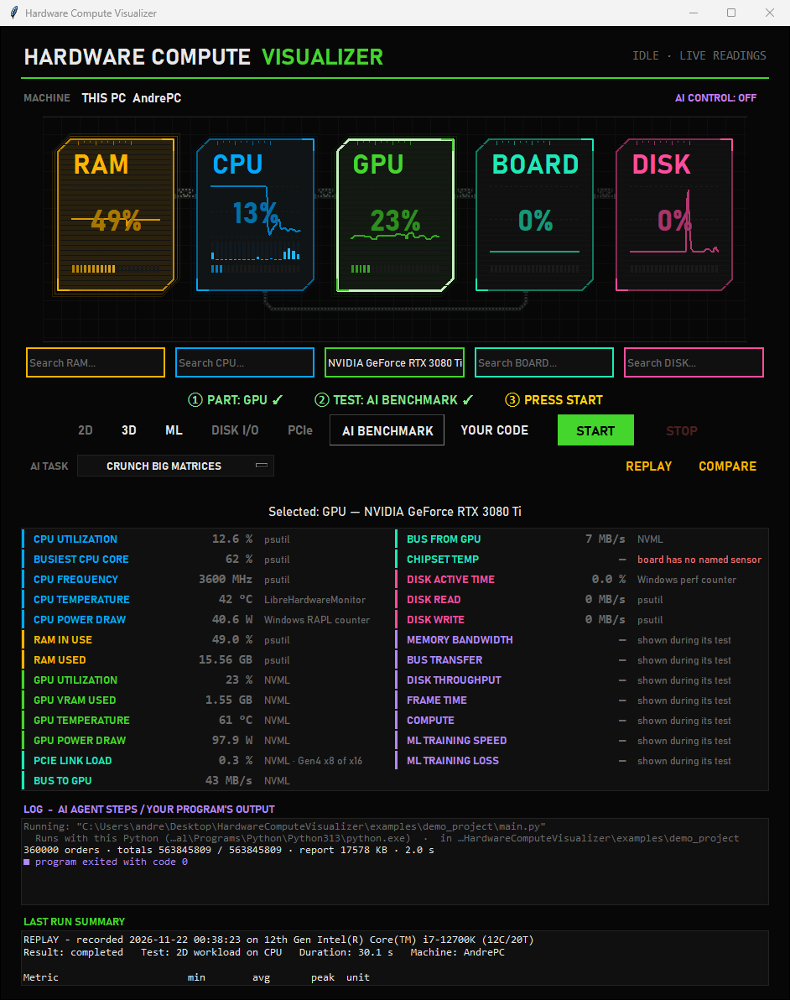

*AT-5a_ai_ready.png*

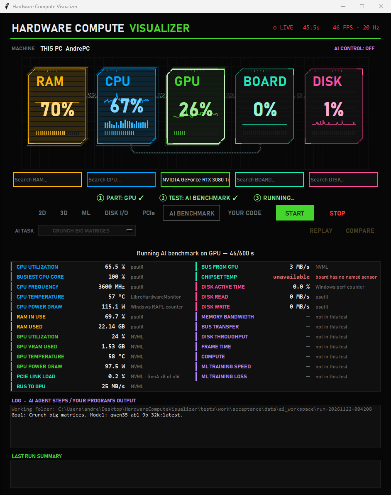

*AT-5b_ai_working.png*

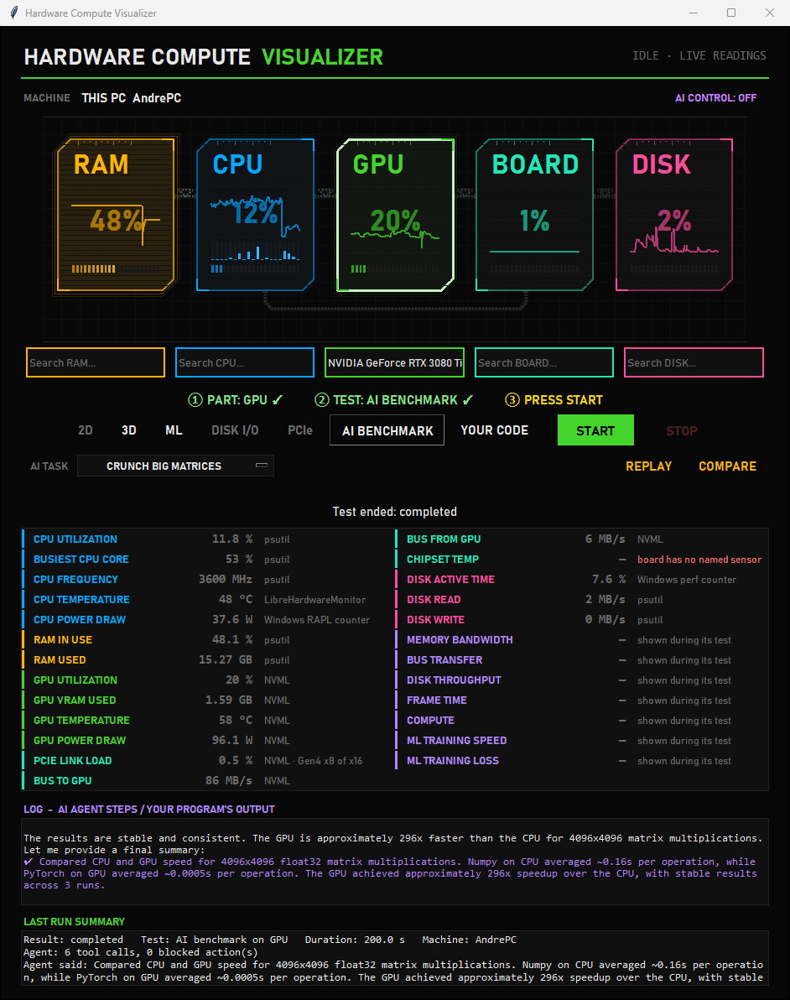

*AT-5c_ai_summary.png*

---

## AT-6

### Stop a running test

**Covers:** UC-8  
**Preconditions:** App open.

**Steps**

1. Click RAM, choose 2D, press START.
2. After about 8 s press STOP.

**Expected:** The workload ends at once, the status says `stopped by user`, START is enabled again, and the partial run is summarized and recorded.

**Observed:** pass.

- Status line: `Test ended: stopped by user`
- Shown as running afterwards: no
- STOP took 0.11 s to end the run
- The window answered every request within 0.11 s

Summary (first lines, and the bottleneck finder's part):

```
Result: stopped by user   Test: 2D workload on RAM   Duration: 8.6 s   Machine: AndrePC

Metric                      min        avg       peak  unit         prev avg   change
...
Bottlenecks: none found - no single pattern held for 10% of the run.
```

**Screenshots**

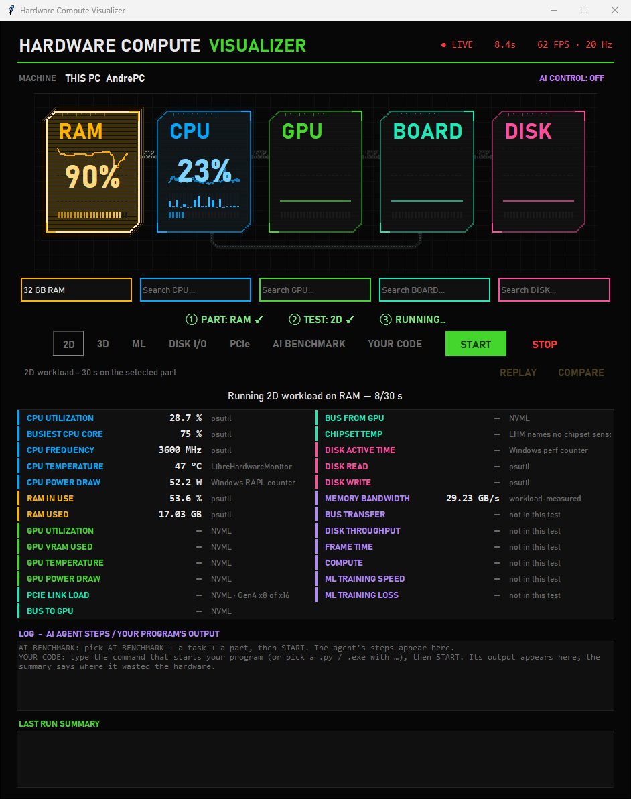

*AT-6a_ram_running.png*

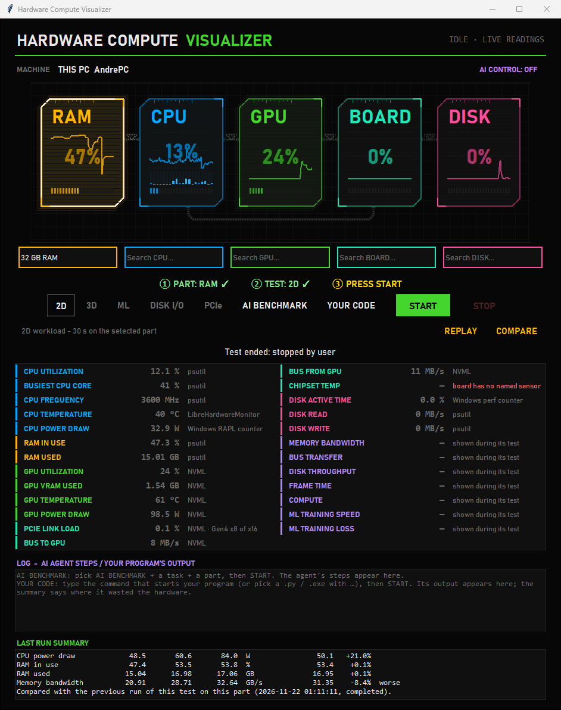

*AT-6b_ram_stopped_summary.png*

---

## AT-7

### Invalid start requests are refused

**Covers:** UC-13  
**Preconditions:** App just opened (nothing selected).

**Steps**

1. Press START with no part selected.
2. Click CPU, choose YOUR CODE, leave PROGRAM empty, press START.
3. Type a program that doesn't exist (`C:\no\such\program.exe`), press START.

**Expected:** Each request shows a pop-up that says what is wrong; nothing is shown as running and no telemetry stays on screen.

**Observed:** pass.

- Status line: `Your program failed to start: RuntimeError: can't start C:\no\such\program.exe: The system cannot find the file specified`
- Pop-ups said: "Select a component first (click a part or search for it)." / "Type the command that starts your program in PROGRAM (or pick a file with …)." / "Your program failed to start: RuntimeError: can't start C:\no\such\program.exe: The system cannot find the file specified"
- Shown as running afterwards: no

**Screenshots**

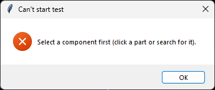

*AT-7a_no_part_popup.png*

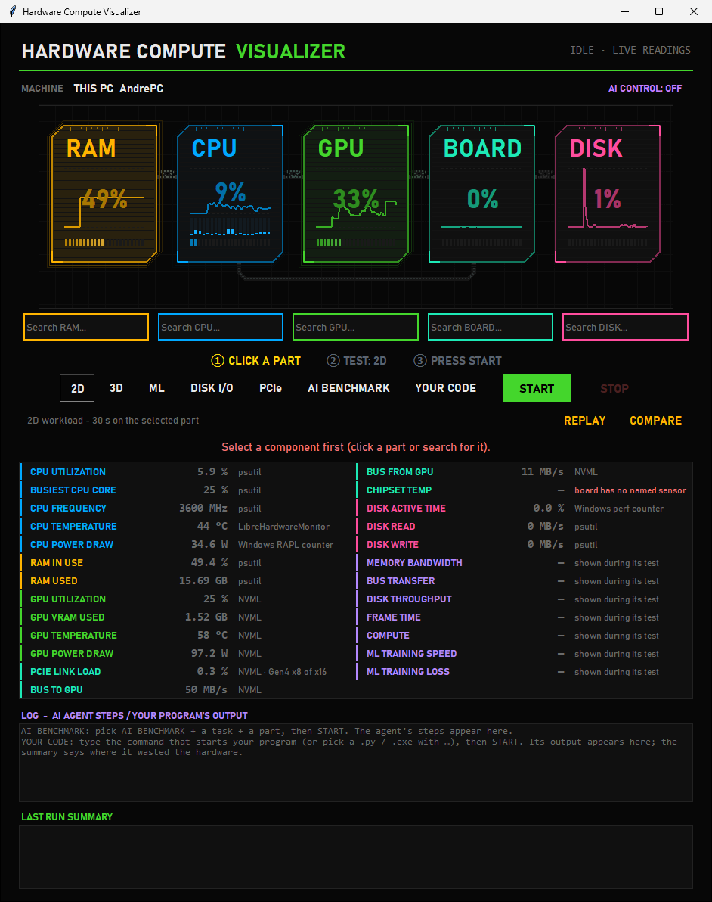

*AT-7b_no_part_status.png*

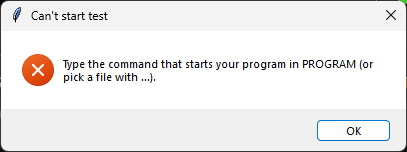

*AT-7c_no_command_popup.png*

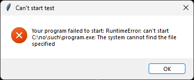

*AT-7d_cannot_start_popup.png*

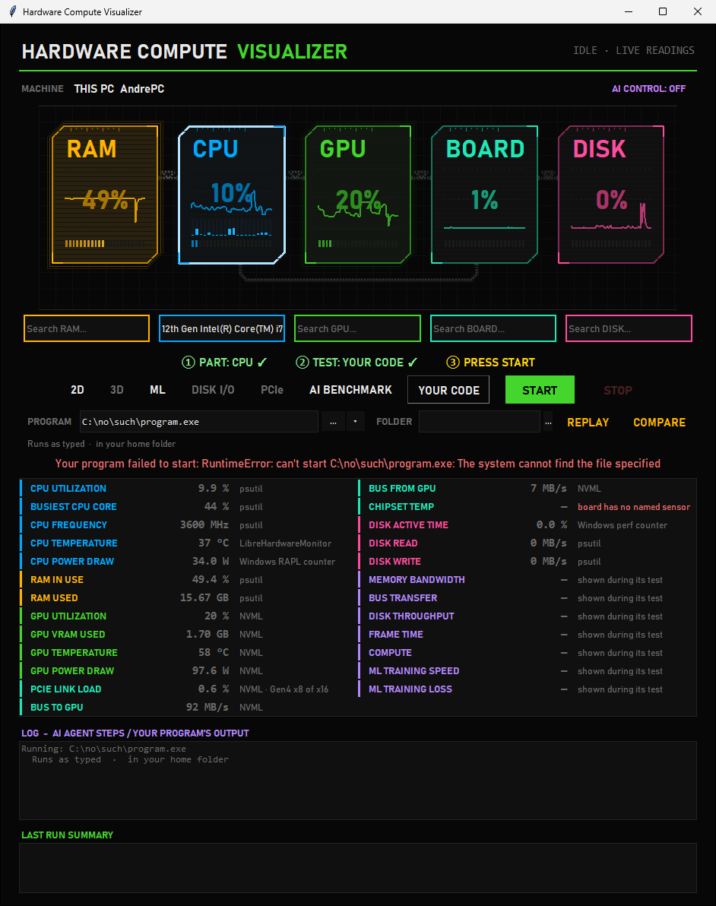

*AT-7e_after_failed_start.png*

---

## AT-8

### YOUR CODE: your own program and its bottlenecks

**Covers:** Ultimate goal (SRS VI.3)  
**Preconditions:** `examples/demo_project` and its requirements (numpy) installed.

**Steps**

1. Click CPU.
2. Choose YOUR CODE.
3. PROGRAM: `examples/demo_project/main.py`.
4. Press START.

**Expected:** The program runs with its project's Python and folder (shown under PROGRAM); its output appears in the log intact; when it exits the summary shows the exit code, every reading and the bottlenecks.

**Observed:** pass.

- Status line: `Test ended: program exited with code 0`

Summary (first lines, and the bottleneck finder's part):

```
Result: program exited with code 0   Test: Your program on CPU   Duration: 2.4 s   Machine: AndrePC
Program: "C:\Users\andre\Desktop\HardwareComputeVisualizer\examples\demo_project\main.py"

...
Bottlenecks: none found - no single pattern held for 10% of the run.
```

**Screenshots**

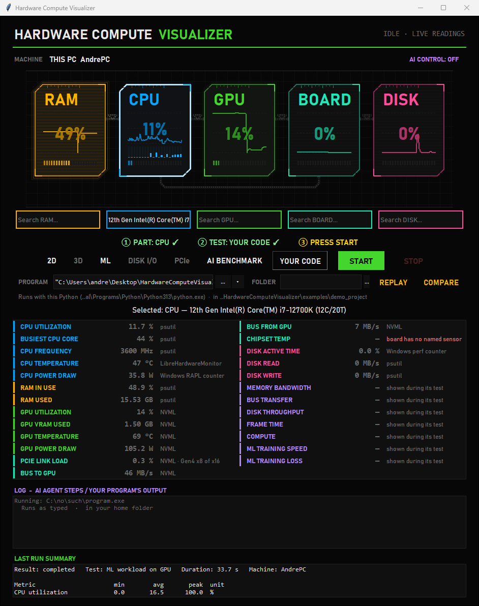

*AT-8a_your_code_ready.png*

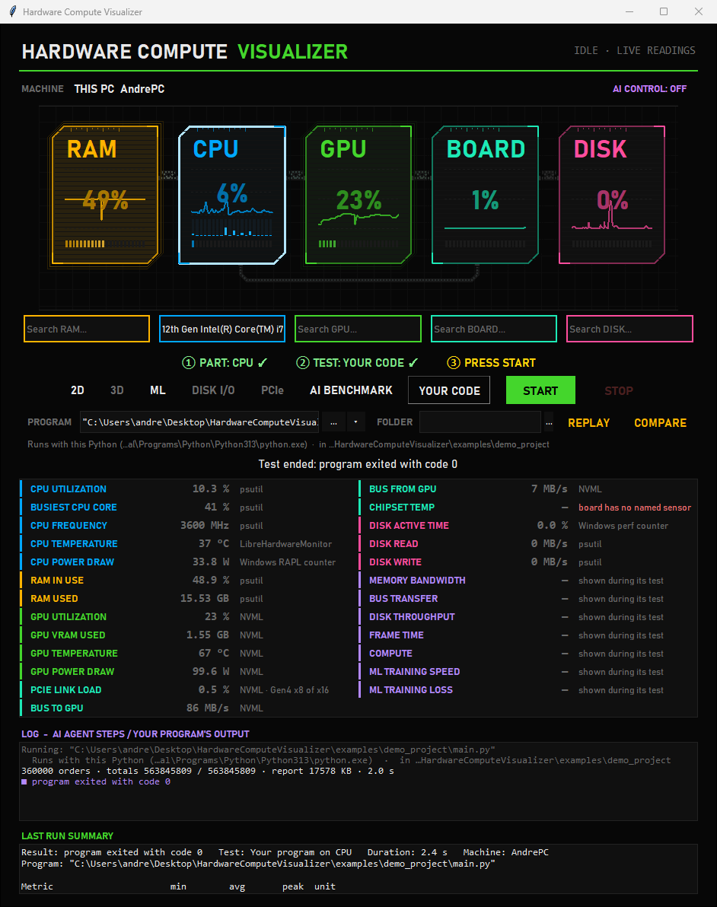

*AT-8b_your_code_running.png*

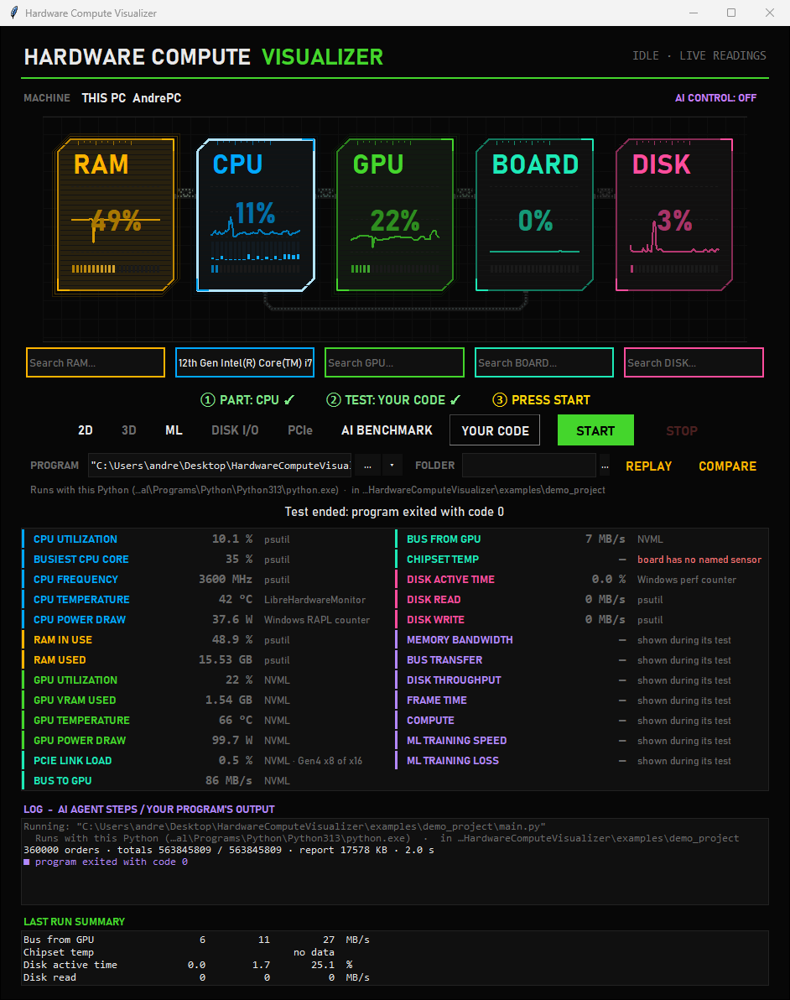

*AT-8c_your_code_summary.png*

---

## AT-9

### Hot spots in VS Code

**Covers:** Ultimate goal (SRS VI.3)  
**Preconditions:** VS Code with the HCV Hot Spots extension, open on `examples/demo_project`; its eye menu (right-click the yellow ▶) on Everything, the default - the speed boxes are hidden in the Memory-only views.

**Steps**

1. Profile the demo project (the yellow ▶ in VS Code; the test runs `profiler.py` the same way).
2. Open `app/compute.py` and `app/loader.py`.

**Expected:** The slowest lines are boxed and ranked (#1, #2 …) with their share of the run; lines below each other form one box; the profile also lists the bottlenecks.

**Observed: FAILED** - checked on the screenshots: no boxes are drawn. VS Code's eye menu was set to a Memory-only view (hcv.show.speed = false) and the profile had no memory data, so nothing was shown. Re-run with the eye menu on Everything.

**Screenshots**

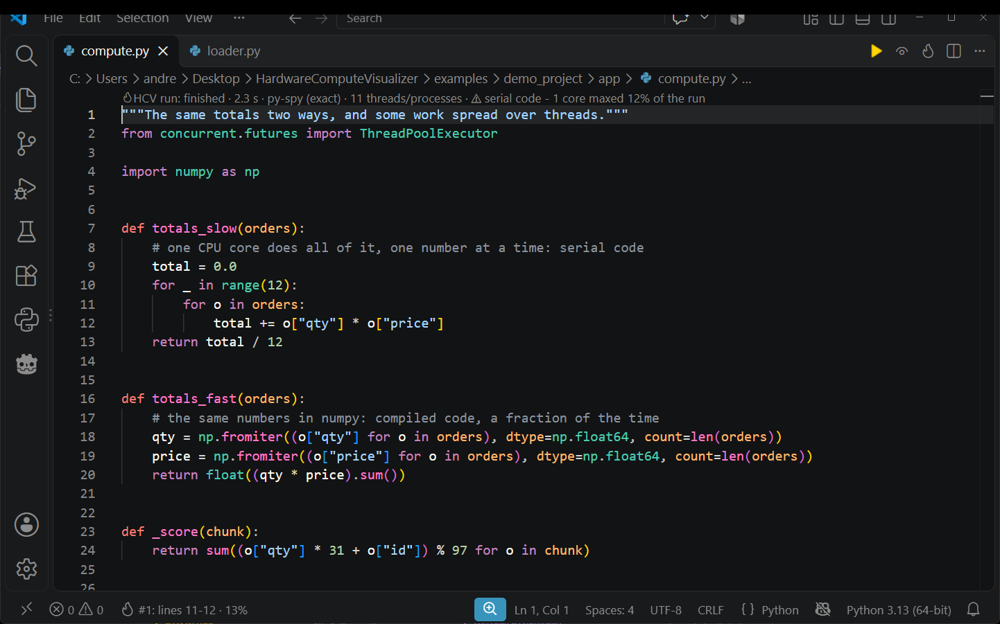

*AT-9a_vscode_compute.png*

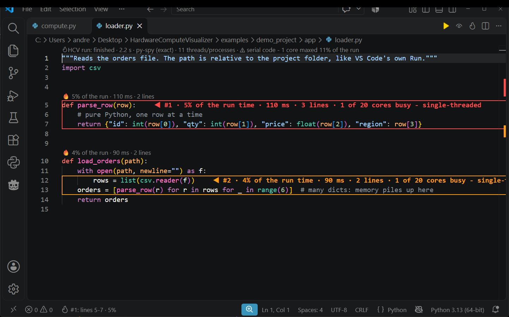

*AT-9b_vscode_loader.png*

---

## AT-10

### Compare two runs and replay a recording

**Covers:** Stretch goals (SRS VI.2)  
**Preconditions:** At least two recorded runs (from the cases above).

**Steps**

1. Press COMPARE.
2. Close it; REPLAY the 2D CPU run of AT-3.

**Expected:** COMPARE shows two runs side by side with every average and its change, and a metric over time; REPLAY plays the recording through the diagram with an amber `REPLAY (recorded)` clock and ends with `Replay ended`.

**Observed:** pass.

- Status line: `Replay ended: finished`
- COMPARE window opened ("Compare runs"); replayed `run-20261122-003823-2d-cpu.json`; clock during replay: `▶ REPLAY (recorded)   8.5s`

**Screenshots**

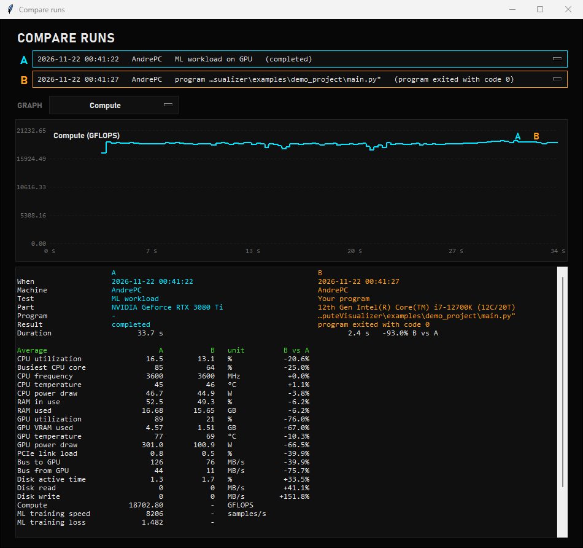

*AT-10a_compare_window.png*

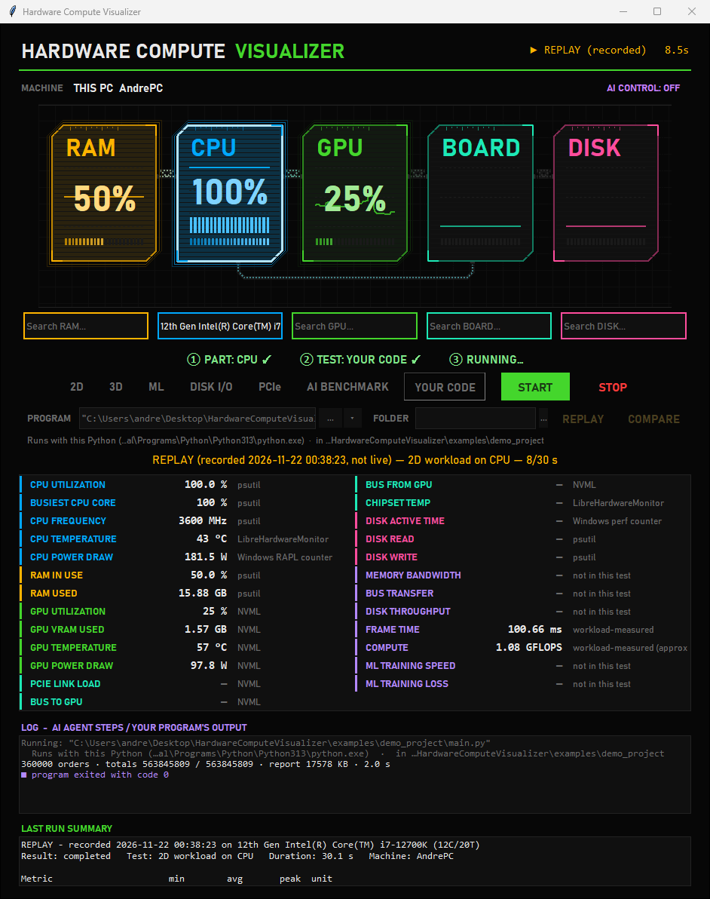

*AT-10b_replay_running.png*

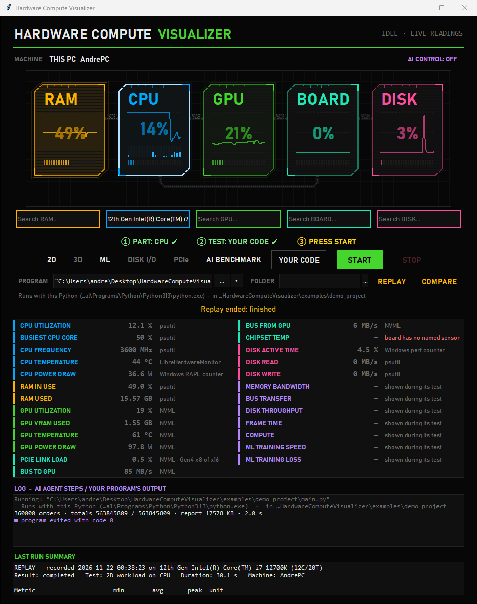

*AT-10c_replay_ended.png*

---

## AT-11

### Other parts: RAM bandwidth, disk I/O, PCIe bus, ML

**Covers:** UC-5, UC-9; stretch goals  
**Preconditions:** NVIDIA GPU with PyTorch (ML, PCIe).

**Steps**

1. RAM + 2D, full 30 s.
2. DISK + DISK I/O.
3. BOARD + PCIe.
4. GPU + ML. START each and wait for the end.

**Expected:** Each test completes with its own measured result (GB/s, MB/s, PCIe GB/s, samples/s and GFLOPS); the RAM summary is compared with the previous (stopped) RAM run of AT-6.

**Observed:** pass.

- The window answered every request within 0.08 s

`ram`: Test ended: completed

```
Result: completed   Test: 2D workload on RAM   Duration: 30.4 s   Machine: AndrePC
Memory bandwidth          25.32      31.73      85.30  GB/s            28.71   +10.5%  better
Bottlenecks (share of the run, longest stretches):
   !  59%  One CPU core maxed while the others sat idle - serial code  [6-10 s, 26-29 s, 24-26 s (+3 more)]
          -> Spread the work over the cores: multiprocessing, vectorised numpy / native libraries, or threads in code that releases the GIL.
```

`disk`: Test ended: completed

```
Result: completed   Test: Disk I/O workload on DISK   Duration: 30.1 s   Machine: AndrePC
Disk throughput            4313       5103       5643  MB/s             5229    -2.4%
Bottlenecks (share of the run, longest stretches):
   !  21%  The disk was busy all the time - waiting on storage  [25-30 s, 6-7 s]
          -> Read less or cache it in RAM, read in big sequential blocks, or use a faster drive.
   !  13%  One CPU core maxed while the others sat idle - serial code  [25-27 s]
          -> Spread the work over the cores: multiprocessing, vectorised numpy / native libraries, or threads in code that releases the GIL.
```

`pcie`: Test ended: completed

```
Result: completed   Test: PCIe bus workload on BOARD   Duration: 32.4 s   Machine: AndrePC
Bus transfer              12.50      12.82      12.90  GB/s            12.81    +0.0%
Bottlenecks (share of the run, longest stretches):
   !  35%  CPU <-> GPU transfers kept the PCIe bus busy  [22-24 s, 12-14 s, 16-18 s (+3 more)]
          -> Copy data to the GPU once and keep it there; use pinned memory and fewer, bigger copies.
  ok  90%  GPU fully busy - the GPU is the limit (good use)  [3-32 s]
          -> Faster only with a faster GPU or less GPU work (lower precision, smaller model).
```

`ml_gpu`: Test ended: completed

```
Result: completed   Test: ML workload on GPU   Duration: 33.9 s   Machine: AndrePC
Compute                15384.55   18347.92   19725.26  GFLOPS       17108.63    +7.2%  better
ML training speed          6750       8051       8655  samples/s        7507    +7.2%  better
Bottlenecks (share of the run, longest stretches):
   !  10%  GPU waiting on the CPU - it was idle while the CPU was busy  [0-4 s]
          -> Feed the GPU faster: bigger batches, load data in worker processes, keep data on the GPU, avoid per-step syncs such as .item() or printing tensors.
  ok  87%  GPU fully busy - the GPU is the limit (good use)  [4-34 s]
          -> Faster only with a faster GPU or less GPU work (lower precision, smaller model).
```

**Screenshots**

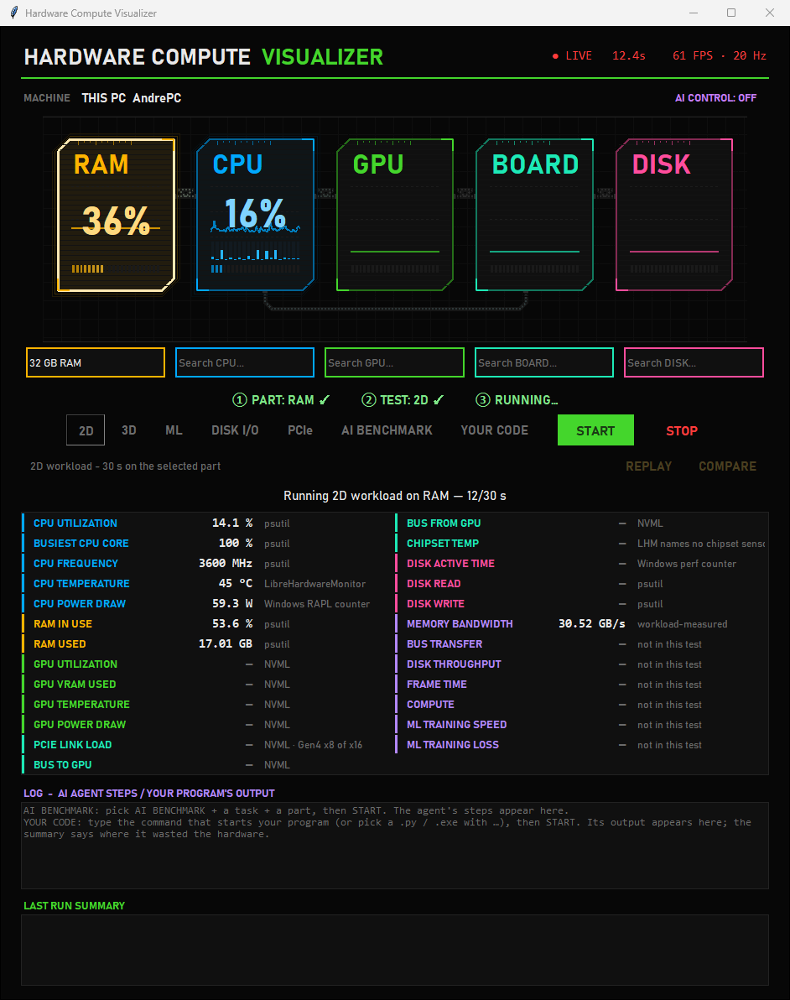

*AT-11_ram_running.png*

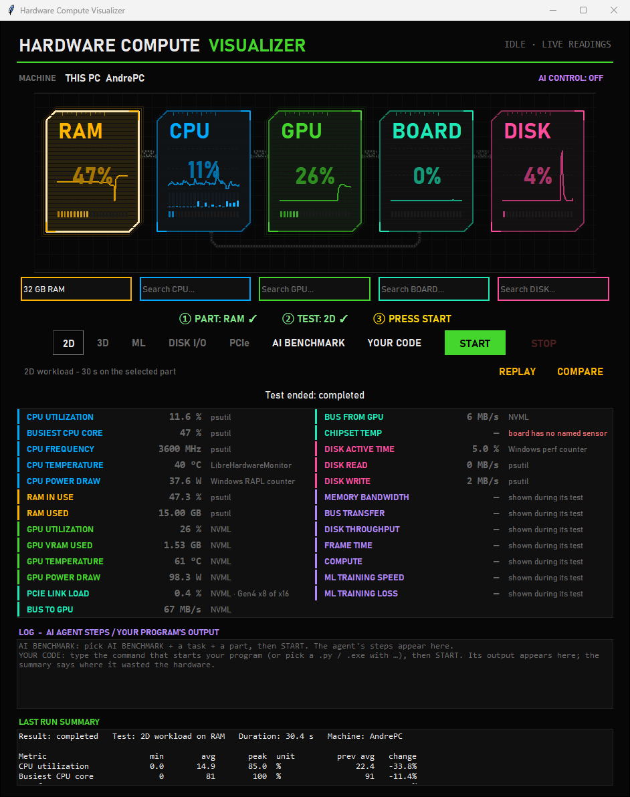

*AT-11_ram_summary.png*

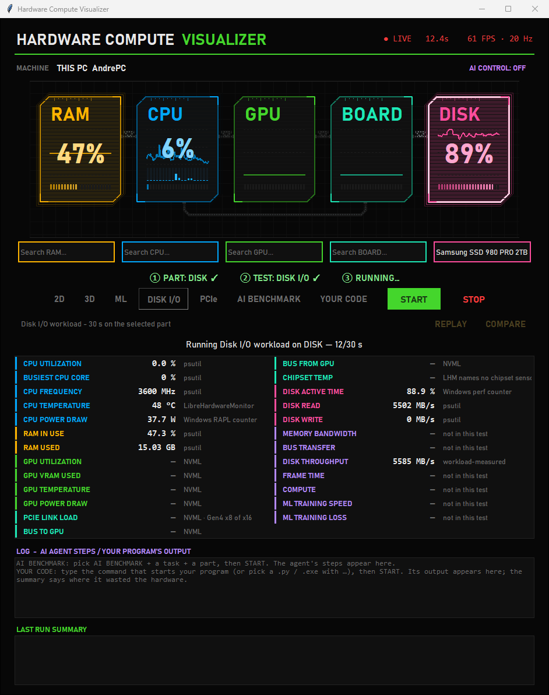

*AT-11_disk_running.png*

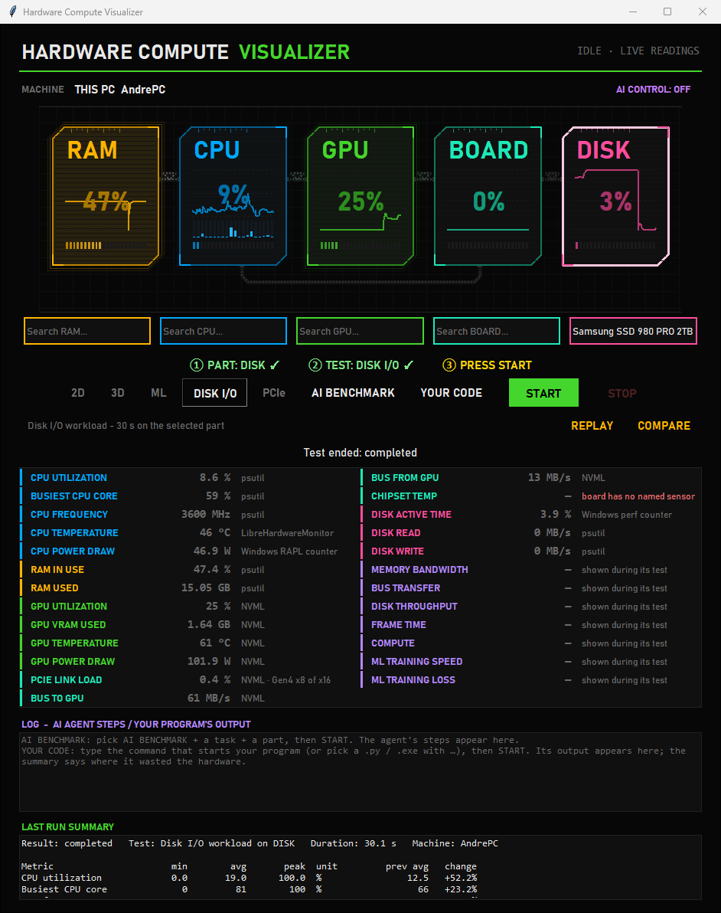

*AT-11_disk_summary.png*

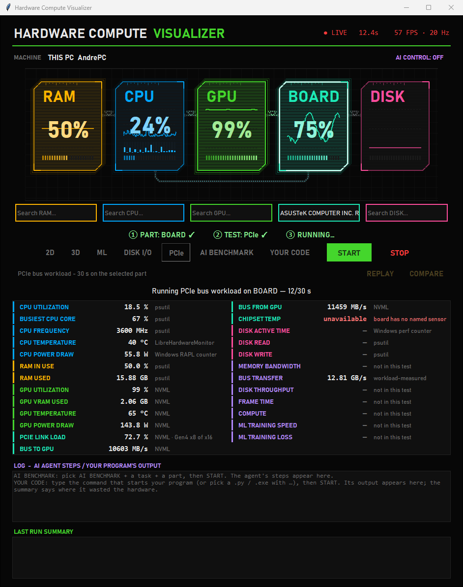

*AT-11_pcie_running.png*

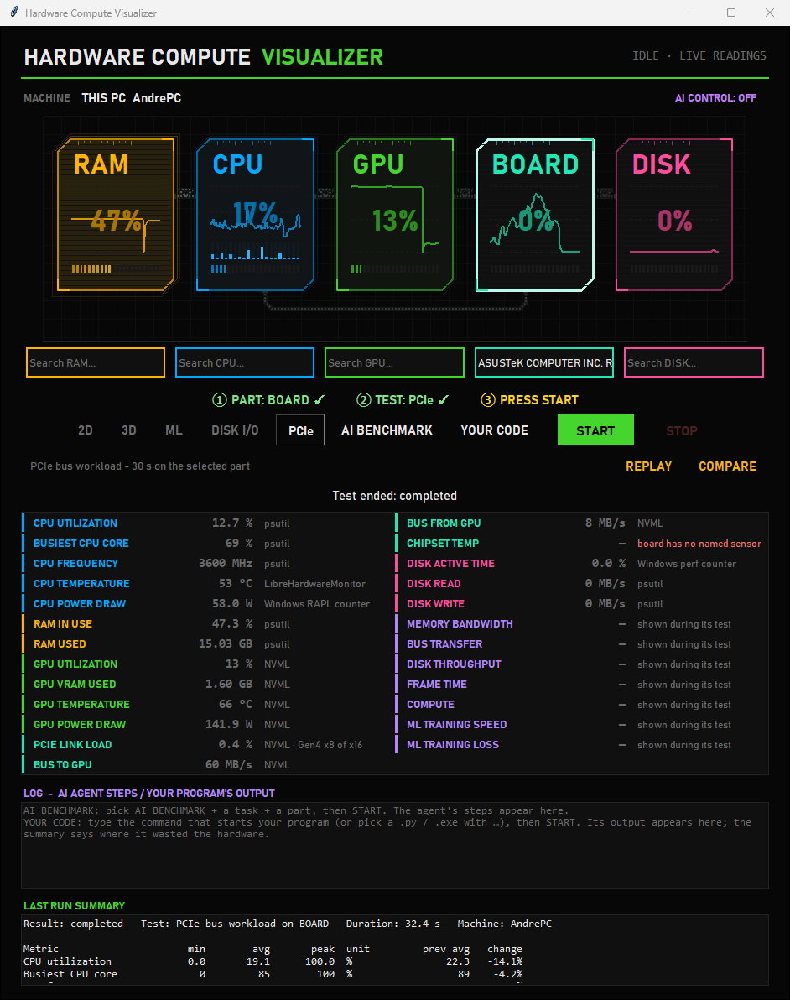

*AT-11_pcie_summary.png*

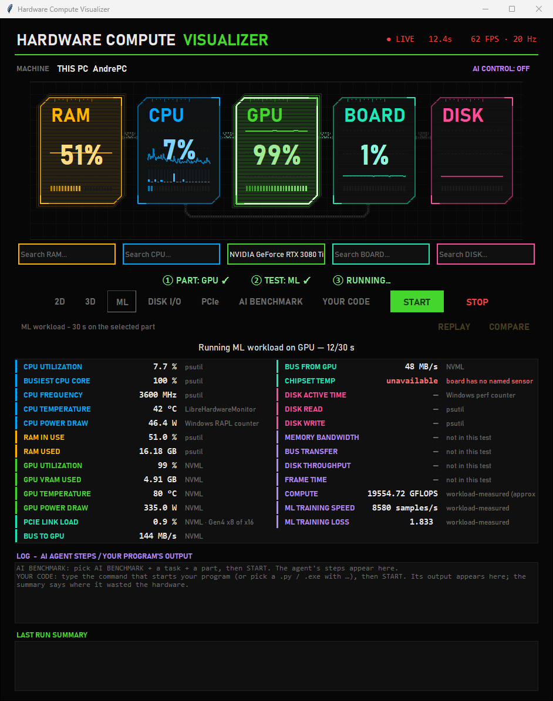

*AT-11_ml_gpu_running.png*

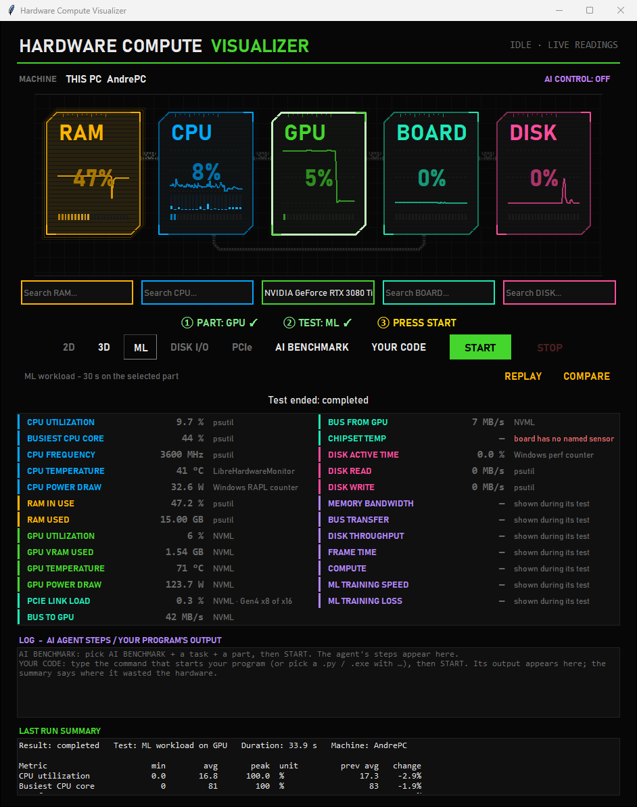

*AT-11_ml_gpu_summary.png*

