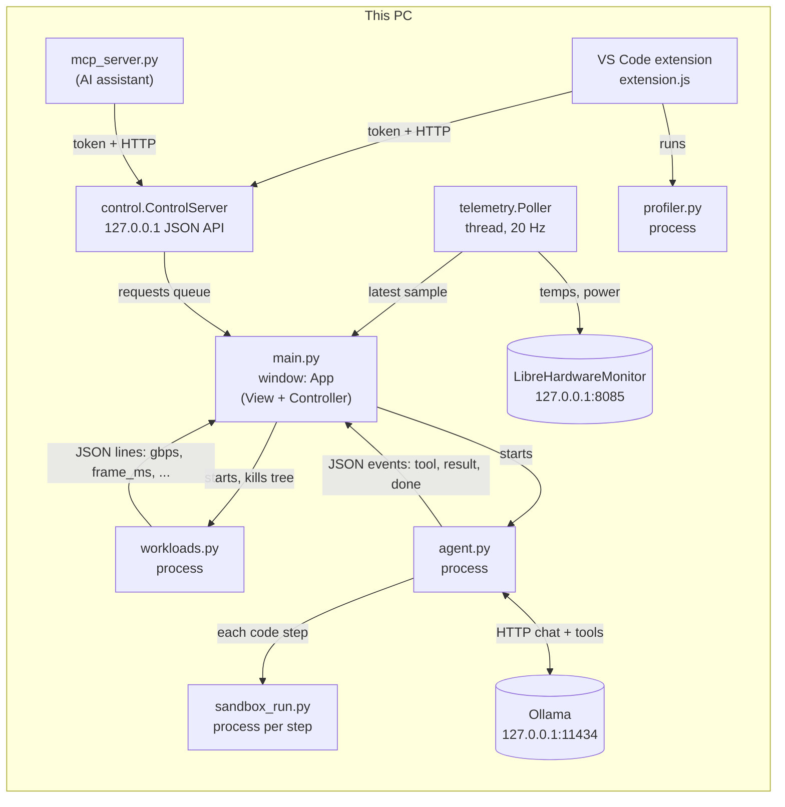
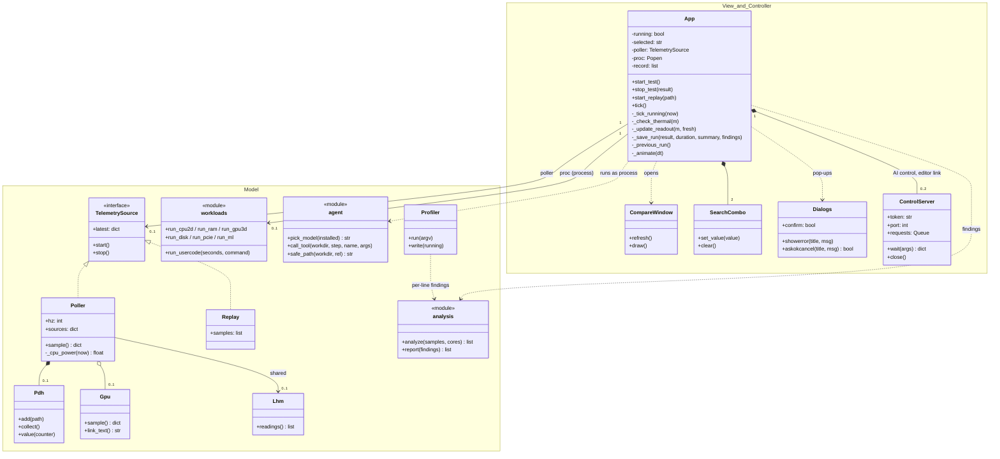

# Structure of the system and its critical algorithms

Hardware Compute Visualizer (HCV): a Windows desktop app (Python 3.11+, Tkinter) that runs a real
workload on one part of a PC (CPU, GPU, RAM, motherboard PCIe link, disk), reads the hardware's
sensors 20 times a second while it runs, and draws a live diagram of the PC that follows the real
readings. It can also run the user's own program and say where that program wastes the hardware,
let a local AI model work on a task, and record, replay and compare runs. Requirements: `SRS_HardwareComputeVisualizer.md` (use cases UC-1 … UC-14,
functional requirements FR-1 … FR-23, non-functional NFR-1 …).

Contents:
1. [Architecture: processes](#1-architecture-processes)
2. [Architecture: Model - View - Controller](#2-architecture-model---view---controller)
3. [UML class diagram](#3-uml-class-diagram)
4. [Modules](#4-modules)
5. [Design principles applied](#5-design-principles-applied)
6. [Critical algorithms](#6-critical-algorithms)
7. [Requirements → design → tests](#7-requirements--design--tests)

---

## 1. Architecture: processes

Every workload runs **in its own operating-system process**, never inside the window's process.
A workload that hangs, crashes or uses every core can't freeze the window, and STOP can always end
it by killing its process tree (FR-10, FR-17). Processes talk through **one JSON object per line**
on stdout / stdin.

| Process / thread | Started by | Talks through | Why separate |
|---|---|---|---|
| `main.py` (Tk main loop, 60 FPS) | the user | - | the window must never block |
| `telemetry.Poller` thread | `App.start_test` | shared `latest` dict | fixed 20 Hz, independent of drawing |
| `workloads.py <test>` | `App.start_test` | stdout JSON lines | a real workload (all cores, the GPU) must not slow the window; killable |
| `agent.py` | `App.start_test` (AI test) | stdout JSON events | the model's 10-minute task runs apart from the UI |
| `sandbox_run.py` | `agent.run_python`, per step | exit code, stdout, `BLOCKED:` lines | each piece of AI-written code is isolated and time-limited |
| `ControlServer` threads | the app | HTTP on 127.0.0.1 → a queue the UI thread drains | AI CONTROL and the VS Code link without touching Tk from another thread |

---

## 2. Architecture: Model - View - Controller

| Layer | Classes / modules | Responsibility |
|---|---|---|
| **Model** (no UI code) | `telemetry.Poller`, `Pdh`, `_PdhGpu`, `_Lhm`; `nvgpu.Gpu`; `workloads`; `analysis`; `agent`, `sandbox_run`; `main.Replay`; `profiler.Profiler`; recorded runs (`runs/*.json`) | detect the hardware, read sensors, run the workloads, record samples, find bottlenecks, run the AI agent |
| **Controller** | `main.App` event handlers: `start_test`, `stop_test`, `_tick_running`, `_check_thermal`, `_update_readout`'s UC-12 rule, `start_replay`, `_save_run`, `_previous_run`, `_ai_do`; `control.ControlServer` (the same actions for an AI or VS Code) | turn user (or AI) actions into model calls, apply the rules of the use cases (validation, time limits, thermal abort, telemetry lost), decide how a run ended |
| **View** | `main.App` drawing: `_draw_part`, `_animate`, readout labels, summary, log; `SearchCombo`, `Tooltip`, `CompareWindow`; `_Dialogs` (pop-ups) | show the diagram, numbers, log and dialogs; 60 FPS animation |

**Where the design is not pure MVC:** `App` holds both the Controller methods and the View
(Tkinter's widgets and their callbacks live in one class, ~1,800 lines). The Model is fully separate:
no Model module imports `tkinter` or `main`, so every Model class can be run and tested on its own
(`tests/unit/`). The Controller methods read their state from fields, not from widgets, which is
why `tests/unit/test_controller.py` can test them on a stand-in object without opening a window.
The natural next refactoring is to move the Controller methods into their own `TestSession` class.

---

## 3. UML class diagram

The full, auto-generated diagram (every attribute and method of every class, regenerated by a
Claude Code hook after each edit) is `CLASS_DIAGRAM.md`. The diagram below is the **design view**:
the important classes, their key members, the layers, and the relationships.

Notes on the relationships:
- **`TelemetrySource`** is the interface the controller programs against: `Poller` (live sensors)
  and `Replay` (a recording) both offer `start()`, `stop()` and `latest`. `_tick_running` and
  `_animate` don't know which one they have, so a replay reuses all the drawing code.
- Python has no `interface` keyword: `TelemetrySource` is implicit (duck typing). It is shown as
  an interface because that is the design.

---

## 4. Modules

| Module | Lines | Layer | Purpose |
|---|---|---|---|
| `main.py` | 2,369 | View + Controller | the window (`App`), compare window, replay, run records |
| `telemetry.py` | 600 | Model | hardware detection; sensor polling (psutil, Windows PDH counters, RAPL power, NVML, LibreHardwareMonitor) |
| `nvgpu.py` | 110 | Model | NVIDIA GPU readings (NVML): load, VRAM, temperature, power, PCIe traffic |
| `workloads.py` | 438 | Model | the real benchmark workloads, each run as its own process |
| `analysis.py` | 150 | Model | bottleneck finder (algorithm 6.1) |
| `agent.py` | 250 | Model | AI Benchmark Mode agent loop (algorithm 6.4) |
| `sandbox_run.py` | 110 | Model | restrictions for AI-written code (algorithm 6.5) |
| `profiler.py` | 790 | Model | line profiler for the user's code, linked to hardware readings (algorithm 6.6) |
| `control.py` | 189 | Controller (API) | local JSON API for AI CONTROL and the VS Code extension |
| `mcp_server.py` | 133 | adapter | lets an AI assistant use the control API (Model Context Protocol) |
| `gen_diagram.py` | 220 | tool | regenerates `CLASS_DIAGRAM.md` from the source (`ast`) |
| `vscode-extension/extension.js` | - | separate client | "Hot Spots" in the editor: runs `profiler.py`, draws boxes on slow lines |

---

## 5. Design principles applied

| Principle | Where |
|---|---|
| **Separation of concerns / layering** | Model modules never import the UI; workloads, agent and profiler are separate programs with a JSON-lines contract |
| **Program to an interface (polymorphism)** | `TelemetrySource` (Poller / Replay): the controller and the diagram don't know if data is live or recorded, section 3 |
| **Open/closed, data-driven** | parts, tests and readouts are tables (`PARTS`, `TESTS`, `OBSERVED`, `STATS`, `analysis.PATTERNS`): adding a part or a test is a table entry, the diagram and menus lay themselves out (NFR-5) |
| **Adapter** | `_Dialogs` replaces `tkinter.messagebox`: same calls, but under AI control a pop-up goes to the log so nobody has to click it |
| **Single source of truth** | `CLASS_DIAGRAM.md` is generated from the code by a hook; README tables come from the same constants |
| **Fail safe / truthful display** | a missing reading shows "unavailable", never 0 or a guess (FR-11); stale workload numbers expire after 1 s; replays are amber and never pass as live |
| **Least privilege** | the app needs no admin; sensors are read-only; the AI's code runs in a sandbox; the control API is localhost-only with a per-session token; no network connections leave the PC |
| **Robustness** | every workload in its own process, killed as a tree (terminate, then kill after 2 s); the frame loop catches every exception (FR-17) |

---

## 6. Critical algorithms

### 6.1 Bottleneck finder (`analysis.py`), written from scratch

**Input:** the recorded samples of a run (`t` in seconds, plus `cpu_util`, `cpu_core_max`,
`cpu_cores`, `gpu_util`, `gpu_vram`, `disk_util`, `board_util`, `ram_util`; any may be missing).
**Output:** the patterns that held for at least 10 % of the run, each with its share, seconds and
longest stretches, problems first.

1. **Does the run use the GPU?** Yes if the GPU reached 30 % at some point, or VRAM grew by
   ≥ 0.1 GB. (Otherwise an idle GPU says nothing about the program.)
2. **Smooth:** replace each sample by the average of the samples in the second before it
   (`_windowed`, two-pointer sliding window, O(n)). A single 50 ms reading of one core is too
   coarse to judge from; the OS also moves a busy thread between cores.
3. **Classify each moment** (`_states`) into a set of patterns:

   | Pattern | Rule (on the 1-s averages) |
   |---|---|
   | serial | more than 2 cores, busiest core ≥ 70 %, whole CPU ≤ max(1.6, min(3, 0.2 × cores)) cores of work, and the GPU not ≥ 90 % |
   | cpu_bound | whole CPU ≥ 85 % |
   | gpu_bound | GPU ≥ 90 % |
   | gpu_starved | run uses the GPU, GPU < 40 %, and busiest core or whole CPU ≥ 80 % |
   | pcie | PCIe link load ≥ 60 % |
   | disk | disk active ≥ 90 % |
   | ram | RAM in use ≥ 92 % |
   | idle | busiest of core / GPU / disk < 20 % and CPU < 15 % |

4. **Integrate over time:** for each consecutive pair of samples, add the time between them to
   every pattern that holds, and track when each pattern starts and stops holding (open / closed
   stretches).
5. **Filter and sort:** keep patterns with share ≥ 10 %, keep stretches ≥ 1 s, sort problems
   before good findings, then by share.

Cost: O(n) time and memory for n samples (a 30-s test at 20 Hz is 600 samples). The same
`_windowed` + `_states` are reused by the profiler to say which pattern held while each line of
the user's code ran (6.6). Tested by 24 cases in `tests/unit/test_analysis.py`, including every
threshold boundary.

### 6.2 Fixed-rate telemetry sampling and RAPL power (`telemetry.Poller`)

- A daemon thread samples every `1/20` s; it sleeps for the period **minus** the time the sample
  took, so slow reads don't lower the rate (measured ≥ 15 samples/s in the unit test; the UI shows
  the live rate, e.g. `20 Hz`). A read that throws is skipped, never ends polling.
- Rates (disk MB/s, CPU %) need two readings: the poller keeps the previous counters and divides
  by the real time between them.
- **CPU watts from the Windows RAPL energy counter:** each reading is the average power since the
  previous collection, which can be only a few ms (noisy). The poller keeps the last 0.5 s of
  `(time, interval, mW)` and returns **energy ÷ time** = Σ(interval × mW) ÷ Σ interval, and
  nothing until it has 150 ms of data. Tested in `RaplTest` (an energy-weighted mean of 40 W where
  a plain mean would say 60 W).

### 6.3 60 FPS animation driven by real data (`App.tick`, `App._animate`)

- `tick` re-schedules itself at the **next 1/60 s boundary** (`1000 × (1/60 − time spent)` ms), not a
  fixed 16 ms, which drifts below 60 FPS. Windows' timer normally wakes every 15.6 ms (≈ 48 FPS),
  so the app asks for 1 ms timer resolution while open (`timeBeginPeriod(1)`, `_fine_timer`).
- Each part's brightness **eases toward the latest real sample** (`level += (target − level) ×
  min(1, 12·dt)`), so motion is smooth but never goes past a real value; an unavailable reading
  sends the part to 0 and shows "UNAVAILABLE".
- The bus lines between parts move their dash offset at a speed proportional to the average load
  of the two parts they join; the CPU strip has one bar per logical core.

### 6.4 AI agent loop (`agent.main`)

A bounded loop: at most 30 steps, at most 4 replies in a row without a tool call, and the run's
deadline. Each step sends the conversation to the local model with 5 tools; tool calls are
executed and their results appended; `finish` ends it as **done**; anything else ends as
**stopped** or **timeout** (statechart 2 in `docs/STATECHARTS.md`). The model is always unloaded
at the end (`finally`). Paths given to file tools are resolved with `realpath` and must stay under
the working folder (`safe_path`).

### 6.5 Sandbox for AI-written code (`sandbox_run.py`)

The code runs in a fresh Python process with a **PEP 578 audit hook** installed last, after the
script is compiled. The hook sees every sensitive operation and raises `PermissionError` (and
prints one `BLOCKED:` line per distinct refusal) for: any socket use; starting programs
(`subprocess.Popen`, `os.system`, `os.exec*`, `os.spawn*`, `CreateProcess`); writes, renames and
deletes outside the working folder; reads and directory listings outside the working folder, the
Python install and system program folders. `sys.path[0]` is the working folder, so the agent can't
import the app's own modules. The caller adds a time limit. This guards against an AI's mistakes;
it is not a boundary against deliberately hostile code (raw `ctypes` stays possible because
PyTorch needs it).

### 6.6 Line profiler linked to hardware (`profiler.py`)

- Every 5 ms a sampler thread reads the main thread's stack (`sys._current_frames()`), walks up to
  the innermost frame **in the user's project** (not site-packages, not venvs, not the Python
  install) and adds the elapsed time to that line, so time inside numpy or PyTorch is charged to
  the user's line that called it.
- At the same time it records hardware samples (10 per second) and keeps a 100 ms timeline of
  which line ran most.
- After the run, `_states_by_line` maps each hardware moment to the line running then (binary
  search in the timeline) and runs the bottleneck finder's `_states` on it, so the editor can say
  "one core busy, GPU idle while this line ran".
- When `py-spy` is installed it gives the final, exact line times (it samples from outside the
  process, so it also sees long C calls, threads and child processes).

---

## 7. Requirements → design → tests

| Requirement (SRS) | Implemented in | Verified by |
|---|---|---|
| UC-1 detect hardware | `telemetry.detect_hardware` | acceptance test AT-1 |
| UC-2 remote machine | withdrawn in SRS v1.1 (feature removed) | - |
| UC-3/4 select a part | `App._select`, `SearchCombo` | AT-2 |
| UC-5/6 2D / 3D test | `workloads.run_cpu2d/run_ram/run_gpu3d`, `App.start_test` | `test_workloads.py`, `StartLaunchTest`, AT-3, AT-4 |
| UC-7 AI benchmark | `agent.py`, `sandbox_run.py` | `test_agent.py`, AT-5 |
| UC-8 stop | `App.stop_test`, `_kill_tree` | `StopTest`, AT-6 |
| UC-9 test completes | `App._tick_running`, `_show_summary`, `_save_run` | `EndOfRunTest`, `RecordedRunsTest`, AT-3 |
| UC-10/11 live diagram and stats | `App._animate`, `_update_readout`, `Poller` | `PollerLiveTest`, AT-3 |
| UC-12 telemetry failure | `App._update_readout` | `SafetyTest` |
| UC-13 test fails to start | `App.start_test`, `_fail`, `_tick_running` | `StartValidationTest`, `EndOfRunTest`, AT-7 |
| UC-14 thermal abort | `App._check_thermal`, `start_test` warning | `SafetyTest`, `StartValidationTest` |
| Ultimate goal: user's code + bottlenecks | `workloads.run_usercode`, `analysis`, `profiler`, extension | `test_workloads.py`, `test_analysis.py`, integration + system tests, AT-8, AT-9 |
| Record / replay / compare (stretch) | `App._save_run`, `start_replay`, `CompareWindow` | `RecordedRunsTest`, AT-10 |

AT-n = acceptance test case in `docs/ACCEPTANCE_TESTS.md`.
