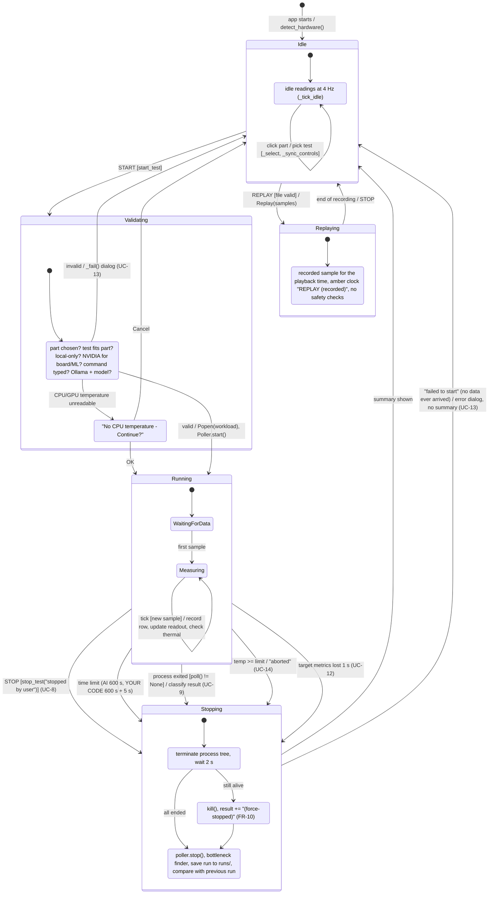
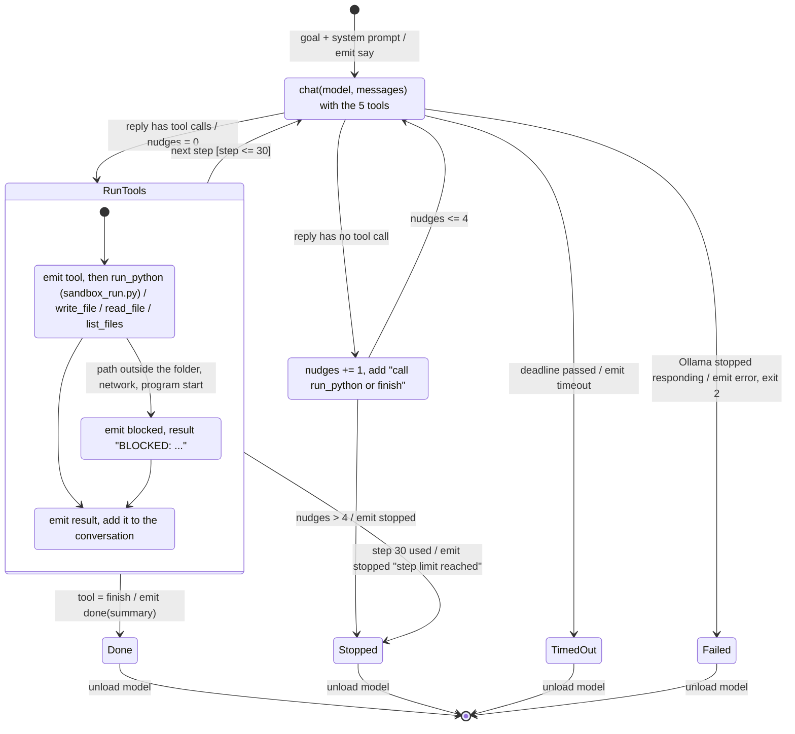
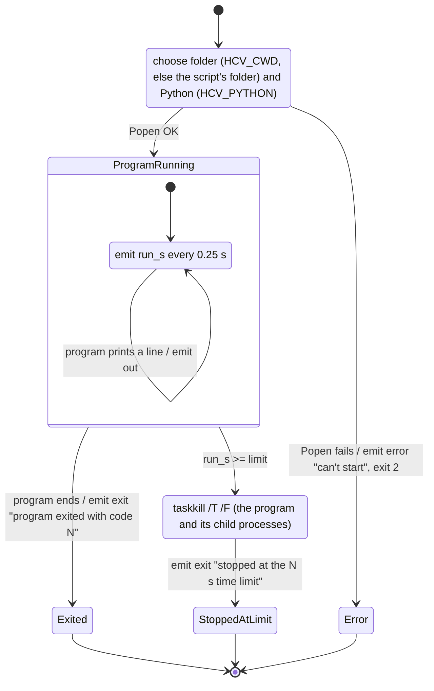

# System statechart diagrams

Three statecharts describe the behavior of the Hardware Compute Visualizer. Each one is taken
from the code, and every transition names the method or event that causes it. Rendered images
are in `docs/img/` (`statechart_*.png`); the Mermaid source below is what they are drawn from
(`python docs/render_diagrams.py`).

| # | Statechart | Object | Code |
|---|---|---|---|
| 1 | Test session | `main.App` (the controller) | `start_test`, `_tick_running`, `_check_thermal`, `_update_readout`, `stop_test`, `start_replay` |
| 2 | AI Benchmark agent | `agent.main` (its own process) | the step loop in `agent.py` |
| 3 | Workload process: YOUR CODE runner | `workloads.run_usercode` (its own process) | `run_usercode`, `kill` |

---

## 1. Test session (`main.App`)

The app is always in exactly one of **Idle**, **Running a test** or **Replaying**. While a test
runs, every frame (60 per second) runs `_tick_running`, which checks the exit conditions in the
order shown. A test can end in several ways; each gives a result text in the summary and
in the saved run.

**Result texts** of a finished test (from `_tick_running` and `stop_test`):

| How it ended | Result |
|---|---|
| benchmark ran its full time | `completed` |
| AI agent called `finish` | `completed` |
| AI agent quit without `finish` | `agent stopped without finishing (<reason>)` |
| AI / YOUR CODE reached its limit | `time limit reached` |
| YOUR CODE ended by itself | `program exited with code N` |
| workload reported an error after data | `failed — <error>` |
| no data ever arrived | dialog `<test> failed to start: <error>` (no summary, nothing shown as running) |
| STOP | `stopped by user` (+ ` (force-stopped)` if it had to be killed) |
| temperature limit (CPU 95 °C; GPU the lower of 90 °C and the vendor's slowdown temperature) | `aborted — thermal limit (CPU 96 °C)` + warning dialog |
| target metrics lost ≥ 1 s | `stopped — CPU telemetry lost` |

A REPLAY file that can't be read (no samples, unknown part) is refused with a `_fail()` dialog and the app stays Idle.

---

## 2. AI Benchmark agent (`agent.py`)

The agent runs in its own process. A local Ollama model decides each step; the program only
enforces the limits (`MAX_STEPS = 30`, `MAX_NUDGES = 4`, the run's deadline) and the sandbox.
It prints one JSON event per transition, which `App._drain_events` shows in the log.

---

## 3. YOUR CODE runner (`workloads.run_usercode`)

---

## How the statecharts were checked

The transitions above are exercised by the unit tests (`tests/unit/`):

| Statechart | Transitions tested in |
|---|---|
| 1 Test session | `test_controller.py` - `StartValidationTest` (every Validating → Idle refusal, the Cancel on AskNoSensor), `StartLaunchTest` (Validating → Running), `EndOfRunTest` (every Running → Stopping exit and its result text), `SafetyTest` (thermal, telemetry lost, replay exempt), `StopTest` (KillTree / ForceKill / Summarize) |
| 2 AI agent | `test_agent.py` - `AgentLoopTest` (Done, Nudge → Stopped, nudge reset, Blocked, tool error, step limit, time limit) |
| 3 YOUR CODE runner | `test_workloads.py` - `UserCodeTest` (Launch choices, Error, Exited, KillTree → StoppedAtLimit with child processes) |
